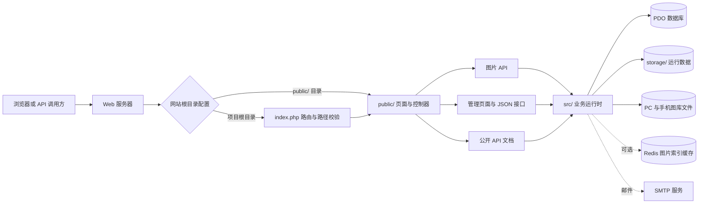

# PicAPI

## 项目用途

PicAPI 用来把自己保存的图片变成一个可管理、可调用的图片服务。它解决的是“图片文件散落在服务器上，网站还要自己找文件、维护图片链接”的问题：你把 PC 和手机图片放进图库并按分类整理，PicAPI 提供固定的 HTTP 地址；每次请求时服务按设备或分类选出一张图片并返回。接入方不需要知道文件名，也不必自己实现随机抽图逻辑。

常见用法是给博客、个人主页、壁纸页面、社群机器人或其他应用提供随机配图。调用方可以直接把接口地址作为图片地址，也可以请求 JSON 或图片 URL，再由自己的程序处理。管理员通过后台上传、筛选和管理图片，查看请求统计与访问日志，并设置限流、黑白名单等访问控制。服务由你部署和管理，图片库、站点设置与日志留在自己的服务器上。

最简单的使用方式是在网页中把接口当作图片源：

```html

```

需要固定设备或分类时，改用 `/pc/`、`/m/` 或添加 `category` 参数；需要在程序中读取图片信息时，使用 `?type=json`。具体示例见下方“图片与 API 使用”。

## 主要功能

- 自适应、PC、手机图片接口；支持随机图片、分类、图片链接或 JSON 响应。
- 管理后台提供图库与分类管理、分批浏览、访问控制、访问和登录日志、统计、站点及 API 设置。
- 初始化向导支持 SQLite、MySQL、PostgreSQL、SQL Server；邮件和 Redis 可按需配置。
- 提供公开接口文档，并支持在后台编辑文档内容。

## 项目目录

| 路径 | 用途 |
| --- | --- |
| `index.php` | 根目录统一入口。将 `/admin/`、`/docs/`、`/pc/`、`/m/` 等公开地址安全地转发到 `public/`。 |
| `public/` | 对外页面、路由控制器和静态资源；也可按服务器示例配置为网站根目录。 |
| `public/admin/` | 后台页面、管理 API、上传、账号和设置功能。 |
| `public/docs/` | 公开 API 文档页面。 |
| `public/pc/`、`public/m/` | PC 和手机图库资源及接口入口。图片按分类目录存放。 |
| `src/` | PHP 业务逻辑，包括 API、图库、缓存、安全、设置和邮件服务。 |
| `templates/admin/` | 后台登录、初始化和工作台页面模板。 |
| `storage/` | 运行时数据：数据库、安装配置、会话、日志、安全状态和缓存。不要公开或提交其中的数据。 |
| `config/` | Nginx 根目录部署和 `public/` 根目录部署的配置示例。 |
| `bin/` | 维护命令及计划任务脚本，例如每日邮件摘要。 |

根目录的 `.htaccess`、`web.config` 和 `public/` 下对应文件用于 Apache、IIS 的访问控制与 URL 重写。`public/admin/assets/vendor/` 内含第三方前端库及其各自的许可证文件；这些文件应与对应库一起保留。

## 架构概览

PicAPI 是一个单体 PHP 应用，代码按功能分布在路由与页面、业务运行时以及数据库和文件存储逻辑中。它还没有独立的存储适配层，也不是由多个服务组成的微服务系统。部署时可以把项目根目录或 `public/` 设为网站根目录：前者由根目录 `index.php` 校验并转发公开路径，后者由 Web 服务器直接处理 `public/` 中的入口。



主要职责如下：

- **入口与界面**：`index.php`、`public/` 和 `templates/admin/` 处理 URL、后台页面、公开文档及管理接口；后台交互由 `public/admin/assets/` 中的 JavaScript 和 CSS 完成。
- **业务模块**：`src/public_api_runtime.php` 负责公开图片请求；`src/image_runtime.php` 管理图片索引、访问统计和日志；`src/media_management.php` 处理图库分类；`src/security_runtime.php`、`src/settings_runtime.php`、`src/setup_runtime.php` 等分别处理安全策略、站点配置和初始化。
- **持久化与外部服务**：PDO 数据库存储管理员、配置文档、分类及运行记录；`storage/` 保存 SQLite 数据库、安装配置、会话、缓存、日志和上传暂存数据；图库图片保存在 `public/pc/img/` 与 `public/m/img/`。Redis 和 SMTP 分别用于可选缓存和邮件发送。

增加功能时，通常在 `public/` 增加受控入口，在 `src/` 实现对应业务逻辑，并按数据性质选择数据库、`storage/` 或图库文件系统。当前运行时模块仍以 PHP 函数和 `require_once` 组合，部分业务编排与存储操作彼此耦合；若后续要扩展或多人并行维护，可以逐步抽出数据库、文件系统和缓存适配层，无需一次性重写现有 URL 与页面。

## 环境要求

- PHP 8.1 或更高版本，启用 PDO、OpenSSL，以及所选数据库对应的 PDO 驱动。
- 支持 SQLite、MySQL、PostgreSQL、SQL Server。SQLite 最便于单机使用。
- PHP 进程需要写入 `storage/`，并需要对 `public/pc/img/`、`public/m/img/` 中的图库执行相应读写操作。
- 首次初始化和开发者重置后，PHP 进程还需短暂写入项目根目录，以创建并删除 `setup.txt`。
- GD 用于缩略图，Redis 用于可选缓存；未启用时使用文件缓存。
- 正式网站应启用 HTTPS，并为 PHP 配置合适的上传大小和执行时间限制。

## 本机启动

在项目根目录执行：

```sh
php -S 127.0.0.1:8768 index.php
```

然后打开：

- 后台：<http://127.0.0.1:8768/admin/>
- 初始化：首次安装时会自动进入初始化向导，也可访问 <http://127.0.0.1:8768/admin/setup.php>
- 公开文档：<http://127.0.0.1:8768/docs/>
- 网站地图：<http://127.0.0.1:8768/sitemap.xml>
- 图片接口：<http://127.0.0.1:8768/>

启动命令末尾的 `index.php` 是必要的路由器。仅运行 `php -S 127.0.0.1:8768` 会让 PHP 内置服务器直接按文件路径查找 `/docs/`，根目录没有 `docs` 文件夹时就会返回资源不存在。80 端口通常需要管理员权限，开发时建议使用 8768 等高位端口。PHP 内置服务器只适用于开发和本机测试，不适合作为生产 Web 服务器。

## 首次初始化

1. 打开 `/admin/`，先从项目根目录的 `setup.txt` 复制本地验证码并填入向导，再填写数据库信息。输入后自动校验，验证成功会删除文件；该文件不通过网站路由提供。SQLite 无需填写账号信息，但所有数据库都要先通过连接测试。
2. 如果启用 Redis，点击测试时系统会先测试数据库，再测试 Redis；测试未通过不能继续。
3. 创建管理员账号。密码最少 8 位；请使用独立且强度足够的密码。
4. 邮件服务可在初始化时配置，也可跳过后到系统设置中配置。未设置邮件时，依赖邮件的验证码、找回密码和通知功能无法使用。
5. 完成向导后使用管理员账号登录。初始化草稿暂存在当前浏览器，并显示最近保存时间。

SQLite 数据库默认放在 `storage/database/`。数据库、安装配置、会话、密钥、日志和缓存都是本地运行数据，不应提交到代码仓库。登录凭证默认保存 7 天，可在系统设置中调整，最大 30 天。

## 图片与 API 使用

将图片放入对应图库分类目录，或登录后台使用上传功能：

- PC 图片：`public/pc/img/<分类名>/`
- 手机图片：`public/m/img/<分类名>/`

管理后台可创建和管理分类。默认图库是系统保留分类。生产环境更新代码前请备份图库和 `storage/` 中需要保留的配置数据。

```text
GET /                         自适应随机图片
GET /pc/                      PC 随机图片
GET /m/                       手机随机图片
GET /?type=json               返回图片 JSON
GET /?type=url                返回图片 URL
GET /pc/?category=default     从指定分类取图
GET /?device=mobile           本次请求指定使用手机图库
GET /?screen_width=390        按屏幕宽度选择图库
```

`type=json` 与 `type=url` 也可用于 `/pc/` 和 `/m/`。分类名称通过 `category` 参数指定；实际可用名称以后台分类管理中显示的接口名称为准。接口支持 GET 和 HEAD。限流、封禁、允许的响应类型等访问策略可在后台访问控制中设置。

首次安装默认填入站点描述、页面标题、搜索摘要和关键词，可在后台“设置 → 站点信息”中修改。`/sitemap.xml` 默认列出公开接口文档页面，`/robots.txt` 会提供对应的网站地图地址；请在后台填写正式站点地址，以生成正确的绝对链接。

## 部署到宝塔或其他 Web 服务器

推荐使用 Nginx、Apache 或 IIS 配合 PHP-FPM/FastCGI，不要把 PHP 内置开发服务器作为公网服务。项目支持两种网站根目录部署方式：

1. **项目根目录作为站点目录**：使用 `config/nginx-root.conf.example`，让请求经过根目录 `index.php`。这样 `/admin/`、`/docs/` 和图片接口都能正常转发，同时避免直接暴露源码目录。
2. **`public/` 作为站点目录**：使用 `config/nginx.conf.example`，将站点根路径指向项目的 `public/`。Apache 和 IIS 可分别使用 `public/.htaccess` 和 `public/web.config`。

在宝塔中创建 PHP 站点后，按选定方式设置运行目录，配置 PHP 版本和数据库，再应用对应的 Nginx/Apache 规则。修改示例中的域名、项目绝对路径、PHP-FPM socket/端口、HTTPS 证书和上传限制。Nginx 不读取 `.htaccess`，必须在 Nginx 配置中加入示例的转发及目录保护规则。不要把站点根目录配置到 `storage/`、`src/` 或 `templates/`。

支持的服务器环境变量：

- `PICAPI_BASE_URL`：配置系统使用的公开站点基址。
- `PICAPI_TRUSTED_PROXIES`：逗号分隔的可信反向代理 IP。

环境变量由服务器或 PHP-FPM 提供；项目不会自动读取 `.env` 文件。

## 维护与备份

- 备份数据库（SQLite 文件或数据库服务器数据）、`public/pc/img/`、`public/m/img/`，以及需要保留的站点设置和安装配置。
- 不要清理运行中的 `storage/`。日志和缓存可按维护策略清理；清除数据库或安装配置会导致站点数据丢失或重新进入安装流程。
- `php bin/daily-summary.php` 可由计划任务定时运行；使用前在后台配置邮件服务、收件人和摘要开关。

## 开源协议

PicAPI 项目代码采用 **GNU GPL-3.0-only**。分发本项目或其衍生版本时，须遵守 GPL-3.0，包括按该协议提供对应源代码。授权说明见根目录 `LICENSE`，完整协议文本见 [GNU GPL 第 3 版](https://www.gnu.org/licenses/gpl-3.0.html)。第三方组件按其各自附带的许可证授权，不因本项目协议而改变。
